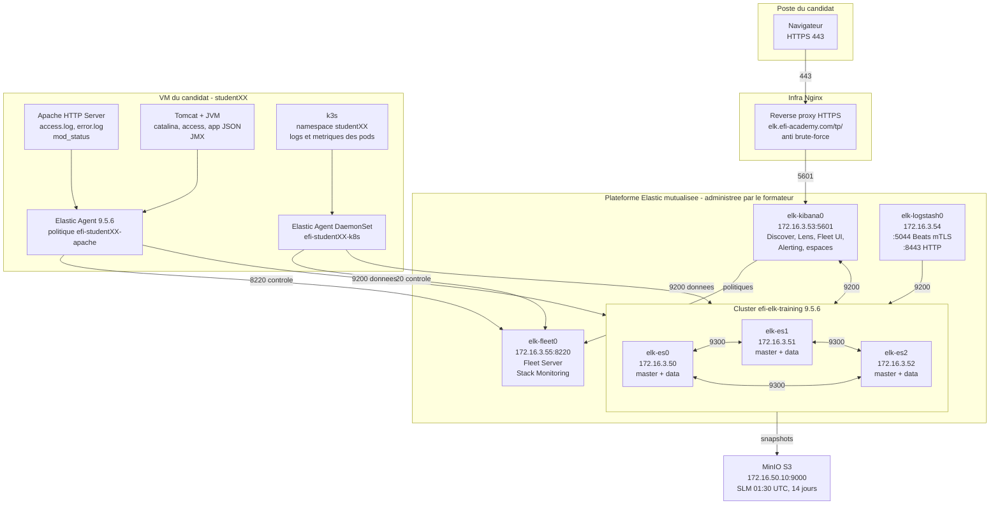

# Introduction — L'architecture en détail

| Niveau | Durée estimée | Prérequis |
|---|---|---|
| Débutant | 1 h 30 (dont 30 min de vérification d'accès) | SSH et `sudo` sur une machine Linux. Bases de HTTP : méthode, URL, code de réponse. Lire du JSON et du YAML. Notions de pod et de namespace pour le chapitre 3. |

Ce manuel condensé vous fait exploiter une plateforme **Elastic Observability déjà installée** pour superviser une application de bout en bout : un serveur web **Apache**, un backend **Tomcat** sur JVM, puis une application trois tiers sur **Kubernetes**.

Le fil rouge est fictif : la boutique en ligne **ShopFlow**, éditée par la société **NovaCommerce**. Toutes les données, erreurs et pannes du manuel concernent cette application de démonstration.

Vous n'administrez pas la plateforme Elastic. Vous l'utilisez — comme en entreprise. Ce que vous administrez, c'est **votre VM**, **votre politique d'agent**, **votre namespace** et **vos objets Kibana**.

> **À retenir** — L'observabilité ne consiste pas à « installer un agent ». Elle consiste à pouvoir répondre à une question que l'on ne s'était pas posée à l'avance, avec les données déjà collectées. Les quatre chapitres entraînent cette capacité : collecter, chercher, corréler, décider.

---

## 1. Le schéma d'ensemble



Lisez ce schéma dans les deux sens : les **données** montent de votre VM vers le cluster, la **configuration** descend de Kibana vers vos agents en passant par Fleet Server.

> **À retenir** — Deux flux, deux ports, deux rôles. L'agent parle à **Fleet Server sur 8220** pour recevoir sa politique et remonter son état de santé. Il parle à **Elasticsearch sur 9200** pour écrire les données. Si vous confondez les deux, vous chercherez une panne de collecte là où il n'y en a pas.

---

## 2. Le rôle de chaque composant

### 2.1 Elasticsearch — stocker et chercher

Base de données distribuée orientée **documents JSON**, conçue pour la recherche et l'agrégation. Trois nœuds (`elk-es0`, `elk-es1`, `elk-es2`), tous **master + data**.

| Notion | Définition | Conséquence pratique |
|---|---|---|
| Document | Un objet JSON : une ligne de log, un point de métrique | L'unité que vous lisez dans Discover |
| Index | Une collection de documents partageant un mapping | L'équivalent d'une table |
| Mapping | Le schéma : nom et type de chaque champ | **Immuable** pour un champ existant |
| Shard | Un morceau d'index | Unité de répartition et de parallélisme |
| Réplica | Une copie d'un shard sur un **autre** nœud | Tolérance de panne et débit de lecture |

Avec trois nœuds éligibles master, le cluster tolère la perte **d'un** nœud (quorum de 2 sur 3). Il ne tolère pas la perte de deux : il passe en lecture seule ou devient indisponible. C'est pourquoi on ne redémarre jamais deux nœuds en même temps — et pourquoi vous n'intervenez pas sur ces machines.

> **⚠️ Piège fréquent** — « Je ne peux pas faire de Top 10 sur ce champ » : il est de type `text`, donc analysé en jetons, donc non agrégeable. Cherchez le sous-champ `.keyword`. Et « mon percentile de latence ne marche pas » : le champ de durée est arrivé en chaîne de caractères. On ne change pas le type d'un champ déjà créé : il faut corriger le pipeline, provoquer un rollover, et réindexer si l'historique compte.

### 2.2 Kibana — l'interface unique

`elk-kibana0`, accessible par le reverse proxy Nginx. Ce n'est pas qu'un outil de graphiques : c'est aussi la console d'administration de l'ingestion.

| Section | À quoi elle sert | Chapitres |
|---|---|---|
| Discover | Explorer les documents bruts, champ par champ, en KQL | 1 à 4 |
| Dashboards / Lens | Construire visualisations et tableaux de bord | 1 à 4 |
| Observability → Logs / Metrics | Vues préconstruites par les intégrations | 1 à 3 |
| Observability → Alerts | Règles, connecteurs, historique des alertes | 1 à 5 |
| Fleet | Agents, politiques, intégrations, outputs, tokens | 1 à 4 |
| Stack Management → Index Management | Index, data streams, templates, ILM, pipelines | tous |
| Stack Management → Data Views | Déclarer les ensembles d'index interrogeables | tous |
| Dev Tools → Console | Requêtes Query DSL et ES\|QL directement | 1, 4, 5 |

Chaque candidat travaille dans **son espace Kibana** (`studentXX`) : les objets sauvegardés y sont isolés de ceux des autres.

### 2.3 Fleet Server — le plan de contrôle

`elk-fleet0`, port 8220. Les agents s'y **enrôlent** avec un token, puis viennent y chercher leur politique et y remonter leur état. Il ne traite **aucune** donnée métier : il distribue de la configuration et collecte du statut.

| Objet Fleet | Définition | Qui le crée ici |
|---|---|---|
| Politique d'agent | Un ensemble d'intégrations + namespace + output + monitoring | Formateur |
| Intégration | Un paquet qui apporte collecte, pipelines, mappings, dashboards | Formateur avec le candidat |
| Token d'enrôlement | Une clé liée à **une** politique | Formateur, transmis individuellement |
| Output | La destination des données : Elasticsearch ou Logstash | Formateur |

> **⚠️ Piège fréquent** — Un token d'enrôlement est un **secret**. Quiconque le possède peut enrôler une machine dans votre politique et écrire dans vos data streams. Il ne va jamais dans un canal de discussion, un ticket ou un dépôt Git. Le générateur de chaque chapitre vous le fait saisir localement et ne l'enregistre nulle part.

### 2.4 Elastic Agent — le collecteur unique

Un binaire unique installé sur la machine à observer. Il ne sait rien faire tout seul : son comportement est **entièrement** défini par la politique qu'il reçoit. C'est un superviseur qui lance les processus de collecte sous-jacents ; vous n'interagissez plus avec eux.

Sur la VM du candidat, il y a **deux agents distincts**, et la plateforme EFI met à votre disposition **trois politiques** :

| Agent | Politique utilisée | Ce qu'il collecte | Chapitres |
|---|---|---|---|
| Agent de l'hôte | `efi-studentXX-apache` | Apache, System — puis Tomcat au chapitre 2 | 1 et 2 |
| Agent en DaemonSet dans k3s | `efi-studentXX-k8s` | Logs des conteneurs, métriques kubelet et kube-state-metrics, événements | 3 et 4 |
| *(en réserve)* | `efi-studentXX-tomcat` | Prévue pour un Tomcat installé sur une **VM distincte** | — |

> **⚠️ Piège fréquent** — **Un agent appartient à une seule politique.** Si Apache et Tomcat tournent sur la même VM — c'est le cas de ce manuel — il n'y a qu'un agent d'hôte, donc une seule politique pour les deux : au chapitre 2, les intégrations Tomcat sont **ajoutées à `efi-studentXX-apache`**. La politique `efi-studentXX-tomcat` ne sert que si le formateur vous attribue une seconde VM pour le backend. Enrôler deux fois la même machine avec deux tokens différents ne fonctionne pas.

> **À retenir** — Rien ne se configure sur la machine observée. Le seul acte local est l'installation du binaire et l'enrôlement. Quels fichiers lire, à quelle fréquence, vers quel namespace, vers quelle destination : tout vient de la politique. C'est le changement de paradigme par rapport aux Beats configurés fichier par fichier.

Les quatre états à connaître :

| État | Signification | Première action |
|---|---|---|
| `Healthy` | Tout fonctionne | Rien |
| `Degraded` | L'agent communique mais **un collecteur échoue** | `elastic-agent status --output=full` |
| `Unhealthy` | Erreur bloquante : output, certificat, politique | Vérifier output, CA, identifiants |
| `Offline` | Plus de contact depuis le délai configuré | Machine, service, port 8220 |

### 2.5 Les intégrations

Une intégration est un paquet qui apporte, pour une technologie donnée : la configuration de collecte, les **ingest pipelines** de parsing, les **mappings**, les **index templates**, et souvent des **dashboards** prêts à l'emploi. C'est la différence entre « j'ai des lignes de texte dans Elasticsearch » et « j'ai des documents ECS exploitables avec un dashboard fonctionnel en dix minutes ».

| Intégration | Ce qu'elle apporte | Chapitre |
|---|---|---|
| Apache HTTP Server | `access.log`, `error.log`, métriques `mod_status`, dashboards | 1 |
| System | CPU, mémoire, disque, réseau, logs système | 1 à 4 |
| **Custom Logs (Filestream)** | Lecture de n'importe quel fichier, parsing à définir. Ne pas confondre avec *Custom Logs (Deprecated)*, l'ancien paquet | 1, 2 |
| Apache Tomcat | Parsing Tomcat prêt à l'emploi, si présente au catalogue | 2 |
| Kubernetes | Logs des conteneurs, métriques kubelet / cAdvisor / kube-state-metrics, événements | 3, 4 |
| PostgreSQL | Logs et métriques de la base | 4 |

<!-- À VÉRIFIER : la disponibilité et la version de chaque intégration dépendent du catalogue réellement installé sur la plateforme. Ouvrir Fleet → Integrations et inventorier avant de commencer : les chapitres 2 et 4 proposent une voie de repli explicite si Tomcat ou PostgreSQL manquent. -->

### 2.6 Logstash — la transformation lourde, en option

`elk-logstash0`, port 5044 pour les Beats en mTLS, 8443 en HTTP. Depuis l'arrivée des ingest pipelines et de l'Elastic Agent, Logstash n'est plus obligatoire. Il reste pertinent dans des cas précis :

| Besoin | Logstash est-il justifié ? |
|---|---|
| Enrichir depuis une base externe (JDBC, référentiel CSV) | **Oui** — filtres dédiés |
| Tampon persistant entre la collecte et Elasticsearch | **Oui** — queue persistante |
| Router un même flux vers plusieurs destinations | **Oui** |
| Parser un format maison très irrégulier, à logique conditionnelle complexe | **Oui**, plus confortable qu'un ingest pipeline |
| Collecter des logs Apache standards | Non — l'intégration fait déjà tout |
| Ajouter deux champs fixes à des documents | Non — un pipeline `@custom` suffit |

> **À retenir** — L'ordre de préférence : d'abord l'intégration officielle, puis un ingest pipeline `@custom` pour ajuster, et **seulement ensuite** Logstash si le besoin le justifie. Chaque composant ajouté est un composant à surveiller, à mettre à jour et à dépanner. Dans ce manuel, vous n'utilisez pas Logstash : vous devez savoir dire pourquoi.

### 2.7 Nginx, MinIO et la CA interne

| Composant | Rôle | Ce que vous en voyez |
|---|---|---|
| Nginx | Reverse proxy HTTPS, point d'entrée unique sur `elk.efi-academy.com`, protection anti brute-force, chemin `/tp/` | L'URL par laquelle vous accédez à Kibana |
| MinIO + SLM | Snapshots du cluster vers un stockage compatible S3, tous les jours à 01:30 UTC, rétention 14 jours | Rien — opération formateur. Mais vous devez savoir que la sauvegarde existe et ce qu'elle couvre |
| CA interne | Autorité qui signe les certificats de toute la plateforme : TLS partout | Le fichier à fournir à l'agent avec `--certificate-authorities` |

> **⚠️ Piège fréquent** — `--insecure` fait disparaître le symptôme `x509: certificate signed by unknown authority`, pas le problème : la connexion reste chiffrée mais n'est plus authentifiée. Sur cette plateforme, la CA interne est fournie : utilisez-la. Si le certificat est refusé malgré la CA, vérifiez aussi **l'heure de votre VM** (`timedatectl`) : une horloge décalée invalide un certificat parfaitement valide.

---

## 3. Les concepts clés

### 3.1 Data streams : décoder un nom

C'est la compétence la plus rentable de cette introduction : un nom de data stream vous dit à lui seul d'où vient la donnée.

```text
                logs  -  apache.access  -  student07
                 │          │                 │
                 │          │                 └── NAMESPACE : votre cloison
                 │          │                     (defini dans votre politique)
                 │          │
                 │          └── DATASET : impose par l'integration
                 │              (apache.access, apache.error, tomcat.log,
                 │               kubernetes.container_logs, postgresql.log...)
                 │
                 └── TYPE : logs | metrics | traces | synthetics

   Nom logique du data stream :  logs-apache.access-student07
   Index physiques derriere     :  .ds-logs-apache.access-student07-2026.11.06-000001
```

| Nom | Ce que vous en déduisez |
|---|---|
| `logs-apache.access-student07` | Logs d'accès Apache du candidat 07, intégration Apache |
| `logs-apache.error-student07` | Logs d'erreur Apache, même intégration |
| `metrics-apache.status-student07` | Métriques issues de `mod_status` |
| `logs-shopflow_apache.access_json-student07` | Le journal JSON maison du chapitre 1 |
| `logs-shopflow_tomcat.catalina-student07` | Le journal du conteneur Tomcat, chapitre 2 |
| `logs-kubernetes.container_logs-student07` | `stdout`/`stderr` des conteneurs, via le DaemonSet |
| `metrics-kubernetes.state_pod-student07` | État des pods vu par kube-state-metrics |
| `metrics-system.cpu-student07` | CPU de l'hôte, intégration System |

> **⚠️ Piège fréquent** — N'écrivez jamais directement dans un index `.ds-…` et ne le supprimez jamais à la main : vous casseriez le data stream. Toutes les opérations passent par le nom logique, ou par l'ILM.

### 3.2 ECS — le vocabulaire commun

ECS (*Elastic Common Schema*) est un **vocabulaire normalisé de noms de champs**. Au lieu que chaque source invente son nom pour la même chose, tout le monde utilise le même.

| Information | Sans schéma commun | Champ ECS |
|---|---|---|
| Date de l'événement | `time`, `ts`, `date`, `eventTime` | `@timestamp` |
| IP du client | `clientip`, `remote_addr`, `ip_src` | `source.ip` |
| Code de réponse HTTP | `status`, `code`, `rc` | `http.response.status_code` |
| URL demandée | `uri`, `path`, `request` | `url.path`, `url.original` |
| Nom de la machine | `hostname`, `server`, `node` | `host.name` |
| Niveau de log | `level`, `severity`, `lvl` | `log.level` |
| Nom du service | `app`, `application`, `svc` | `service.name` |
| Type d'erreur | `exception`, `err_class` | `error.type` |
| Durée de l'événement | `duration`, `elapsed`, `took` | `event.duration` (**nanosecondes**) |

La conséquence est très concrète : une même requête `http.response.status_code >= 500` fonctionne sur les logs Apache, sur les logs Tomcat correctement normalisés **et** sur les logs du frontend conteneurisé. Sans ECS, il faudrait trois requêtes différentes et un dashboard par source.

> **À retenir** — ECS est la condition technique de la corrélation. Les intégrations officielles produisent de l'ECS sans effort de votre part. Dès que vous collectez une source maison (chapitres 1 et 2), **c'est à vous** de mapper vos champs sur ECS — et c'est un critère de notation du projet final.

### 3.3 Ingest pipelines et la convention `@custom`

Un ingest pipeline est une suite de **processeurs** exécutés par Elasticsearch au moment de l'indexation : découper une ligne (`grok`, `dissect`), convertir un type (`convert`), renommer (`rename`), calculer (`script`), enrichir (`user_agent`), supprimer un champ sensible (`remove`).

Chaque intégration installe son pipeline. **Vous ne le modifiez jamais directement** : vous créez un pipeline `@custom` que l'intégration appelle automatiquement à la fin du sien.

```text
# Convention Elastic, non negociable :
#   logs-apache.access@custom
#   logs-shopflow_apache.access_json@custom
#   logs-kubernetes.container_logs@custom
#
# Avantage : il survit aux mises a jour de l'integration, contrairement
# a une modification du pipeline par defaut, qui serait ecrasee.
```

### 3.4 ILM : pourquoi les données anciennes disparaissent

L'*Index Lifecycle Management* fait vieillir les index : rollover, passage en phases plus froides, suppression.

| Phase | Ce qui s'y passe |
|---|---|
| Hot | Écriture active, recherches fréquentes |
| Warm | Plus d'écriture, lectures occasionnelles |
| Cold / Frozen | Lectures rares, stockage moins coûteux (licence pour certaines options) |
| Delete | Suppression définitive |

> **⚠️ Piège fréquent** — Avant de chercher pourquoi « les données d'il y a un mois ont disparu », relevez la politique ILM appliquée au data stream : sur une plateforme de formation, la rétention est volontairement courte. Ce n'est pas une panne, c'est le fonctionnement attendu. À ne pas confondre avec les snapshots SLM vers MinIO, qui servent à restaurer le cluster, pas à prolonger votre rétention de recherche.

### 3.5 Logs ou métriques : lequel pour quoi

| Question | Signal adapté | Pourquoi |
|---|---|---|
| Combien de requêtes par seconde ? | Métrique, ou agrégation de logs | Valeur agrégée, suivi de tendance |
| Quelle URL exacte a échoué pour ce client ? | **Log** | Besoin du détail unitaire |
| La mémoire du serveur sature-t-elle ? | **Métrique** | Échantillonnage régulier |
| Quelle exception Java a été levée ? | **Log** | Message et pile d'appels |
| Tendance sur six mois | **Métrique** | Coût de stockage soutenable |
| Preuve d'un événement unique pour un audit | **Log** | Traçabilité unitaire |

> **À retenir** — On peut dériver une métrique d'un log (compter les 5xx par minute), mais c'est plus coûteux que de collecter la métrique directement. Inversement, on ne retrouvera **jamais** le détail d'un événement à partir d'une métrique agrégée. D'où la règle : métriques pour la tendance et l'alerte, logs pour l'enquête.

---

## 4. Le parcours d'une donnée, de bout en bout

Suivons **une seule ligne** d'`access.log`, de son écriture à son affichage.

```text
① 14:13:02.455  Un client demande /api/cart. Apache sert la requete en 4,1 s
   et ecrit DEUX lignes :
     access.log       format combined, SANS duree
     access_json.log  JSON avec "shopflow.duration_us": 4102311

② L'Elastic Agent de la VM surveille les deux fichiers. Il suit chaque fichier
   par son identifiant interne (inode), pas par son nom : une rotation de
   journal ne perd donc aucune ligne.

③ L'agent envoie la ligne a Elasticsearch sur le port 9200, en HTTPS,
   avec la CA interne et sa cle d'ecriture - obtenue APRES l'enrolement.

④ A l'indexation, Elasticsearch execute le pipeline de l'integration,
   puis le pipeline @custom :
     - json      : les cles du JSON remontent a la racine du document
     - convert   : shopflow.duration_us devient un entier
     - script    : 4102311 microsecondes -> event.duration = 4102311000 ns
     - script    : shopflow.status_class = "2xx"
     - set       : service.name = "shopflow-web"
     - user_agent: navigateur et systeme d'exploitation decomposes
     - set       : event.outcome = "success"  (statut 200)
     - remove    : le champ message brut est supprime

⑤ Le document est ecrit dans le data stream
   logs-shopflow_apache.access_json-studentXX, donc physiquement dans
   un index .ds-... replique sur un deuxieme noeud.

⑥ Dans Discover, votre data view apache-studentXX interroge ce data stream.
   Vous voyez un document : statut 200, duree 4,1 s, 180 Ko de reponse.

⑦ Dans Lens, la formule percentile(event.duration, 95) / 1000000 fait de cette
   ligne un point du P95. Dans une regle d'alerte, event.outcome en fait un
   evenement "bon" ou "mauvais" : c'est la matiere d'un SLI (chapitre 5).

⑧ A 01:30 UTC, le SLM envoie un snapshot vers MinIO. Au-dela de la retention
   ILM, le document est supprime du cluster : c'est normal et prevu.
```

> **À retenir** — Entre ① et ⑥, il s'écoule typiquement 15 à 60 secondes. Mesurez ce **délai d'ingestion** une fois pour de bon : c'est l'écart entre le `@timestamp` du dernier document et l'heure courante. Le connaître évite de conclure à une panne alors que la donnée est simplement en train d'arriver.

---

## 5. Se connecter et vérifier son accès

### 5.1 Ce que le formateur vous remet

| Élément | Exemple | Où il sert |
|---|---|---|
| Identifiant candidat | `student07` | Suffixe de **tous** vos objets |
| Compte Kibana et mot de passe | — | Connexion à l'interface |
| Espace Kibana | `student07` | Vos objets sauvegardés |
| Token d'enrôlement de `efi-student07-apache` | secret | Chapitres 1 et 2 — l'agent de la VM |
| Token d'enrôlement de `efi-student07-k8s` | secret | Chapitres 3 et 4 — le DaemonSet |
| Clé d'API Elasticsearch restreinte | secret | Scripts de vérification |
| Nom d'hôte et IP de votre VM | `vm-student07`, `172.16.20.7` | Les générateurs |
| Chemin de la CA interne | `/etc/efi/pki/ca.crt` | Enrôlement de l'agent |

### 5.2 Les six vérifications d'accès

```bash
# 1. Votre VM, son nom et son adresse : ce sont vos host.name et host.ip
hostname ; hostname -I ; id ; sudo -v && echo "sudo OK"

# 2. L'heure : un decalage invalide les certificats et decale vos logs
timedatectl | grep -E 'Time zone|System clock|NTP'

# 3. La CA interne est-elle presente ?
sudo openssl x509 -in /etc/efi/pki/ca.crt -noout -subject -dates

# 4. Fleet Server repond-il ? Une reponse HTTP, MEME une erreur, suffit :
#    elle prouve que le port est ouvert. Un timeout prouve l'inverse.
curl -sI --max-time 5 --cacert /etc/efi/pki/ca.crt https://172.16.3.55:8220 | head -1

# 5. Elasticsearch repond-il avec votre cle d'API ?
curl -s --cacert /etc/efi/pki/ca.crt \
  -H "Authorization: ApiKey $ES_API_KEY" https://172.16.3.50:9200 | head -12

# 6. Le cluster est-il sain ? (statut green ou yellow attendu)
curl -s --cacert /etc/efi/pki/ca.crt \
  -H "Authorization: ApiKey $ES_API_KEY" \
  "https://172.16.3.50:9200/_cluster/health?pretty" | head -8
```

Puis, dans le navigateur, sur `https://elk.efi-academy.com/tp/` :

1. Vous êtes connecté et **dans votre espace** `studentXX` — vérifiez le sélecteur d'espace en haut à gauche.
2. **Stack Management → Index Management → Data streams** : vous voyez au moins un data stream. Décomposez son nom en type / dataset / namespace.
3. **Stack Management → Index Lifecycle Policies** : relevez la **rétention** avant suppression. Notez-la : elle explique la disparition des données anciennes.
4. **Fleet → Agent policies** : vos politiques `efi-studentXX-apache` et `efi-studentXX-k8s` existent. Ouvrez la première : l'**espace de nom** de chaque intégration doit valoir `studentXX`, et la **sortie** `efi-elasticsearch`.
5. **Fleet → Integrations** : inventoriez ce qui est **réellement** disponible — Apache HTTP Server, System, **Custom Logs (Filestream)**, Kubernetes, Apache Tomcat, PostgreSQL. Notez les versions.
6. **Stack Management → License Management** : relevez le niveau de licence. Il conditionne les SLO natifs et plusieurs connecteurs d'alerte (chapitre 5).

> **⚠️ Piège fréquent** — Vingt candidats travaillent en même temps sur le même cluster. Tout objet que vous créez doit porter votre identifiant, sinon vous écrasez le travail de quelqu'un d'autre.

| Type d'objet | Convention | Exemple |
|---|---|---|
| Data view | `<source>-studentXX` | `apache-student07` |
| Visualisation Lens | `<métrique>-studentXX` | `taux-5xx-student07` |
| Dashboard | `<périmètre>-overview-studentXX` | `apache-overview-student07` |
| Règle d'alerte | `<symptôme>-studentXX` | `taux-5xx-apache-student07` |
| Namespace de data stream | `studentXX` | `student07` |
| Namespace Kubernetes | `studentXX` | `student07` |
| Politique d'agent | `efi-studentXX-<rôle>` | `efi-student07-apache` |

### 5.3 La méthode que vous utiliserez dans tout le manuel

Quand une donnée n'arrive pas, on remonte la chaîne **dans l'ordre**, et on s'arrête au premier point qui échoue.

| Point de contrôle | Comment on vérifie | Si ça échoue |
|---|---|---|
| 1. La source produit-elle ? | `tail -f` sur le fichier, `curl` sur l'endpoint, `kubectl logs` | Ce n'est **pas** un problème Elastic |
| 2. L'agent lit-il ? | `elastic-agent status --output=full`, `elastic-agent inspect` | Chemin erroné, ou droits de lecture |
| 3. L'agent envoie-t-il ? | Logs de l'agent, Agent monitoring dans Kibana | Output injoignable, certificat, authentification |
| 4. Elasticsearch a-t-il reçu ? | `_count` sur le data stream, Discover sur 15 minutes | Mauvais namespace, ou document rejeté par le pipeline |

> **À retenir** — « Ça ne marche pas » n'est pas un diagnostic. « Le point 2 passe, le point 3 échoue avec une erreur de certificat » en est un. Cette discipline est ce qui distingue, en entretien comme en production, un exploitant d'un utilisateur d'outil.

---

## 6. Le parcours en un coup d'œil

| Chapitre | Ce que vous mettez en place | Ce que vous cassez pour apprendre | Durée |
|---|---|---|---|
| 1 — Apache | Logs combined + JSON avec durée, `mod_status`, agent, dashboard, 4 alertes | Montée en charge, flood de 404, erreurs 500, lenteur, arrêt du service | 3 h 00 |
| 2 — Tomcat | Intégration Tomcat, WAR ShopFlow, logs multilignes, métriques JVM | Fuite mémoire jusqu'à l'OOM, lenteur applicative, échec de déploiement | 2 h 30 |
| 3 — Kubernetes | kube-state-metrics, agent en DaemonSet, logs et métriques du namespace | Pending, CrashLoopBackOff, OOMKilled, ImagePullBackOff, readiness, throttling | 3 h 00 |
| 4 — Projet final | ShopFlow 3 tiers sur k3s, dashboard de bout en bout, SLO, alertes | Base indisponible, backend lent, 5xx en cascade | 4 h 00 |
| 5 — SRE et incident | SLI, SLO, error budget, burn rate, échelle de gravité, postmortem | — | 1 h 30 |

**Volume total : environ 14 heures**, soit deux journées de formation.

---

**➡️ Chapitre suivant** : Logs et métriques Apache HTTP Server.
