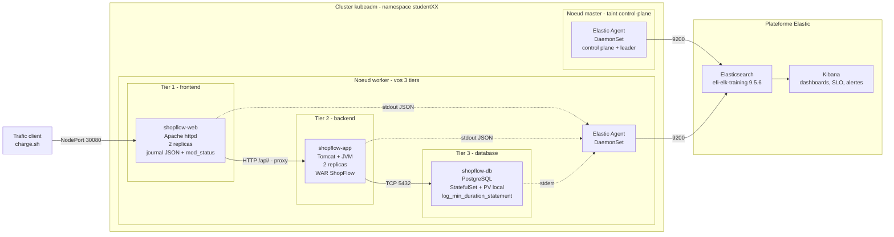

# Chapitre 4 — Projet final : superviser ShopFlow, trois tiers sur Kubernetes

| Niveau | Durée estimée | Prérequis |
|---|---|---|
| Avancé | 4 h 00 — noté sur 100 | Chapitres 1 à 3 terminés. Votre cluster kubeadm (un master + un worker) avec les **deux** agents du DaemonSet opérationnels. WAR ShopFlow construit au chapitre 2. |

Ce projet mobilise tout ce qui précède sur un cas unique et continu. Il ne s'agit pas de refaire les chapitres : il s'agit de **tenir un rôle** — celui de l'ingénieur chargé de l'observabilité d'un service qui génère du chiffre d'affaires, et qui va tomber en panne sans prévenir.

## 1. Le contexte métier

> NovaCommerce exploite la boutique en ligne ShopFlow. Le chiffre d'affaires du site est d'environ **40 000 € par jour**, réparti entre 8 h et 23 h. Le tunnel d'achat — panier, puis commande — est le parcours critique : toute dégradation y est directement convertible en perte de commandes.
>
> Vous êtes l'ingénieur responsable de son observabilité. La veille d'une opération commerciale, votre responsable vous demande deux choses : « est-ce qu'on voit ce qui se passe ? » et « est-ce qu'on sera prévenus avant les clients ? »

## 2. L'architecture à superviser



> **À retenir — ce que le deuxième nœud change pour ce projet.** Le master porte la taint `control-plane:NoSchedule` : **vos trois tiers sont tous sur le worker**, et leurs fichiers de log aussi. Trois conséquences concrètes. **Un** : un NodePort est ouvert sur **tous** les nœuds, donc `curl http://localhost:30080/` fonctionne depuis le master même si aucun pod n'y tourne — kube-proxy relaie vers le worker. **Deux** : c'est le worker qui télécharge les images ; un registre injoignable depuis lui bloque tout, même si le master y accède. **Trois** : le volume de la base est sur le disque du worker, et il y reste — voir la partie 1.

Les trois tiers écrivent sur la **sortie standard** : le runtime capture, le DaemonSet collecte, aucune application ne connaît la plateforme d'observabilité. C'est la règle de conception de toute application conteneurisée.

| Tier | Composant | Ce qu'il apporte au diagnostic |
|---|---|---|
| 1 | Apache httpd, 2 réplicas | Le point de vue de **l'utilisateur** : codes de statut, durée, volume |
| 2 | Tomcat + JVM, 2 réplicas | Le point de vue de **l'application** : exceptions, mémoire, threads |
| 3 | PostgreSQL, StatefulSet + PVC | Le point de vue de la **dépendance** : disponibilité, requêtes lentes |

> **À retenir** — Le frontal expose `/health` qui répond **localement**, sans traverser le backend. Ce choix est délibéré : il permet de distinguer « le frontal est vivant » de « la chaîne complète fonctionne ». Si la readiness du frontal dépendait du backend, une panne de base retirerait **tout** le frontal du Service — et vous n'auriez plus aucune réponse HTTP à observer, donc plus aucun signal.

## 3. Ce qui vous est demandé

| Partie | Objet | Points |
|---|---|---|
| 1 | Déployer et collecter les trois tiers | 25 |
| 2 | Dashboard de bout en bout | 20 |
| 3 | Trois SLO et leur budget d'erreur | 20 |
| 4 | Alerting calibré et testé | 15 |
| 5 | Diagnostiquer un incident **non annoncé** | 15 |
| 6 | Rapport et synthèse | 5 |

### Partie 1 — Déployer et collecter (25 points)

**D'abord le stockage.** Votre cluster kubeadm ne fournit **aucune** StorageClass — contrairement à un cluster managé ou à k3s. Sans elle, le PVC de la base reste `Pending` et le StatefulSet ne démarre jamais. Vérifiez, puis agissez en conséquence :

```bash
kubectl get storageclass
```

| Ce que vous voyez | Ce que vous faites |
|---|---|
| `No resources found` | Appliquez `manifests/05-stockage.yaml` : il déclare une StorageClass, un PersistentVolume local sur le worker, et un Job qui prépare le répertoire |
| Une StorageClass marquée `(default)` | **N'appliquez pas** `05-stockage.yaml` : renseignez son nom dans `STORAGE_CLASS` et passez à la suite |

```bash
cd ../02-tomcat/app && ./build-war.sh && cd -     # si ce n'est pas déjà fait
./manifests/build-configmap-war.sh
kubectl apply -f manifests/00-configmaps.yaml
kubectl apply -f manifests/05-stockage.yaml        # seulement si aucune StorageClass
kubectl -n studentXX wait --for=condition=complete job/preparer-volume-db --timeout=120s
kubectl apply -f manifests/10-secret-postgres.yaml
kubectl apply -f manifests/20-postgres.yaml
kubectl -n studentXX rollout status statefulset/shopflow-db --timeout=240s
kubectl apply -f manifests/30-tomcat.yaml
kubectl -n studentXX rollout status deploy/shopflow-app --timeout=300s
kubectl apply -f manifests/40-apache.yaml
kubectl -n studentXX rollout status deploy/shopflow-web --timeout=120s
```

**✅ Vérification — la chaîne complète, tier par tier**

```bash
curl -s http://localhost:30080/health            # tier 1 seul  -> 200
curl -s http://localhost:30080/api/cart          # tiers 1 et 2 -> 200
curl -s http://localhost:30080/api/db            # les 3 tiers  -> {"db":"up",...}
curl -s http://localhost:30080/api/commande      # le parcours critique -> 201
kubectl -n studentXX get pods,svc,pvc -o wide    # tout doit être sur le worker
kubectl get pv -o wide                           # Bound, et non Available
```

> **⚠️ Piège fréquent** — Un PVC qui reste `Pending` ne dit pas pourquoi dans `kubectl get pvc`. La raison est dans les events : `kubectl -n studentXX describe pvc donnees-shopflow-db-0`. Les deux messages les plus fréquents ici sont « no persistent volumes available for this claim and no storage class is set » (vous avez sauté `05-stockage.yaml`) et un volume qui reste `Available` parce que son `claimRef` ne correspond pas exactement au nom du PVC — lequel est **imposé** par le StatefulSet : `<volume>-<statefulset>-<ordinal>`, donc `donnees-shopflow-db-0`.

Ce que vous devez mettre en place côté collecte :

1. Les **logs des trois tiers** dans `logs-kubernetes.container_logs-studentXX`, avec le JSON décodé pour le frontal et le backend.
2. Un pipeline `@custom` qui convertit `shopflow.duration_us` (microsecondes) en `event.duration` (**nanosecondes**) pour le frontal, et qui pose `shopflow.status_class`.
3. L'intégration **PostgreSQL** configurée dans Fleet, pointant sur le service `shopflow-db`, avec les identifiants du Secret.
4. Les **métriques Kubernetes** des trois tiers, y compris `state_container` (c'est la source de `last_terminated_reason`).
5. Le contrôle qualité : **zéro** document portant `error.message`, et une couverture du champ de durée **supérieure à 99 %**.

> **⚠️ Piège fréquent** — L'intégration PostgreSQL a besoin d'identifiants. Ne les mettez **pas** dans des annotations de pod : elles sont lisibles par quiconque peut faire un `kubectl describe`. Déclarez-les dans l'intégration côté Fleet, qui les stocke comme secrets. Si vous utilisez malgré tout les hints d'autodiscover, signalez-le et expliquez le compromis — c'est une décision à assumer, pas à cacher.

> **⚠️ Piège fréquent** — Le `log_min_duration_statement=200` de PostgreSQL ne trace que les requêtes de plus de 200 ms. Si vous ne voyez aucune requête lente dans les logs de la base, ce n'est pas forcément que tout va bien : c'est peut-être que rien ne dépasse le seuil. Vérifiez d'abord que la journalisation fonctionne, avec `log_connections`.

### Partie 2 — Dashboard de bout en bout (20 points)

Un seul dashboard, nommé `shopflow-e2e-studentXX`, lisible **de haut en bas**, du synthétique au détail.

| Zone | Panneaux attendus |
|---|---|
| Indicateurs | Requêtes du tunnel, taux de 5xx, P95 du frontal, latence de la base, pods non prêts |
| Évolution | Trafic par minute empilé par famille de code ; P50/P95/P99 ; erreurs **par tier** |
| Par tier | Tier 1 : codes et durées. Tier 2 : exceptions, mémoire en % de limite, redémarrages. Tier 3 : connexions, requêtes lentes |
| Détail | Tableau de diagnostic des pods (six colonnes) et recherche sauvegardée des erreurs |

Exigences de forme, qui comptent dans la note :

- Un panneau **Markdown** en tête : objectif, sources, **limites connues**.
- Les couleurs des familles de code fixées : vert `2xx`, orange `4xx`, rouge `5xx`.
- Des contrôles : composant (`app.kubernetes.io/component`), pod, code de statut.
- Un chemin de l'**agrégat vers le détail en trois clics**, que vous décrivez.

### Partie 3 — Trois SLO et leur budget (20 points)

Les requêtes sont fournies dans `requetes/slo.esql`. Votre travail n'est pas de les recopier : c'est de **trancher les décisions** qu'elles contiennent et de les assumer par écrit.

| SLO | Objectif | Fenêtre |
|---|---|---|
| Disponibilité du tunnel de commande | 99,5 % | 7 jours |
| Latence de l'API : part des requêtes sous 1 s | 95 % | 7 jours |
| Disponibilité de la base vue par le backend | 99,9 % | 7 jours |

Pour **chaque** SLO, une fiche d'une demi-page :

1. Les événements **éligibles**, en KQL ou en ES\|QL — la définition exacte du dénominateur.
2. Les événements **bons** — la définition exacte du numérateur.
3. Les cinq décisions suivantes, tranchées et **justifiées** :
   - les 4xx comptent-elles comme des échecs ?
   - les sondes de supervision sont-elles dans le dénominateur ?
   - quel est le **point de mesure** : frontal, backend, ou client ?
   - que fait-on des requêtes **sans champ de durée** ?
   - un échec **rapide** est-il « bon » du point de vue de la latence ?
4. Le **budget d'erreur** : total, consommé, restant — en requêtes **et** en pourcentage.
5. La **couverture** de la mesure : quelle part du trafic le SLI observe-t-il réellement ?

> **À retenir** — La question 5 est celle qui distingue un SLI fiable d'un chiffre. Si 20 % des requêtes n'ont pas de champ de durée et que vous les excluez des éligibles, votre SLI de latence porte sur 80 % du trafic — et peut être très loin de la réalité. Un SLI dont on ne mesure pas la couverture ne vaut rien.

### Partie 4 — Alerting (15 points)

Quatre règles, dont les seuils sont **calibrés sur vos données** (minimum, médiane, maximum relevés sur votre historique) et non recopiés.

| Règle | Niveau | Exigence particulière |
|---|---|---|
| Burn rate du tunnel | 1 | **Double fenêtre** : 1 h et 5 min, les deux vraies |
| Cascade de 5xx par tier | 1 | Le message doit **nommer le tier** en cause |
| Base injoignable | 1 | Mesurée **depuis le backend**, pas depuis la base |
| Absence de données | 4 | **Testée par coupure réelle** de la source |

Pour chacune : garde-fou de volume minimal, regroupement, action de rétablissement, description documentée (objectif, propriétaire, action attendue), et les **deux délais mesurés** — détection et extinction.

### Partie 5 — L'incident non annoncé (15 points)

Le formateur déclenche un incident **sans vous en révéler la nature**. À partir de cet instant, vous êtes chronométré. La méthode attendue :

1. Notez l'heure de prise de connaissance.
2. Qualifiez la gravité **sur l'impact utilisateur** (voir l'échelle du chapitre 5), et justifiez.
3. Rédigez la communication initiale dans les cinq premières minutes : faits établis, incertitudes, heure de la prochaine communication.
4. Diagnostiquez dans cet ordre : **métriques, puis logs, puis corrélation entre tiers**. Consignez chaque hypothèse écartée **et la donnée qui l'a écartée**.
5. Formulez la cause racine en **une phrase**, avec sa preuve.
6. Reconstituez le **début réel** et calculez votre MTTD (écart entre le début réel et votre détection).
7. Chiffrez l'impact : requêtes affectées, commandes perdues estimées, budget d'erreur consommé.
8. Proposez et appliquez la correction, puis **validez par la donnée**. Calculez votre MTTR.

> **Bonne pratique** — Tenez votre journal d'investigation **pendant** l'incident, pas après. Deux lignes par hypothèse, avec l'heure, suffisent. C'est la seule façon de produire ensuite une chronologie exacte : reconstituer de mémoire donne systématiquement un récit plus rationnel que la réalité — et fait disparaître l'information la plus utile, celle qui dit où le temps a réellement été perdu.

### Partie 6 — Rapport et synthèse (5 points)

Un rapport d'incident de deux pages maximum, selon le modèle du chapitre 5, et une synthèse d'une page pour un lecteur **non technique** : état de l'observabilité, incident, trois recommandations priorisées.

Deux règles de rédaction : l'impact est **entièrement chiffré** (aucune formulation qualitative du type « beaucoup d'utilisateurs »), et le rapport ne **désigne aucune personne**, même implicitement.

## 4. Déroulé proposé

| Temps | Partie | Ce que vous faites |
|---|---|---|
| 0 h 00 – 1 h 15 | 1 | Déploiement des trois tiers, collecte, contrôles qualité |
| 1 h 15 – 2 h 00 | 2 | Dashboard de bout en bout |
| 2 h 00 – 2 h 45 | 3 et 4 | SLO, budgets, alertes calibrées et testées |
| 2 h 45 – 3 h 30 | 5 | Incident non annoncé, chronométré |
| 3 h 30 – 4 h 00 | 6 | Rapport et synthèse |

Laissez `charge.sh` tourner **pendant tout le projet** : sans trafic, aucun SLI n'a de sens et un incident ne produit aucun signal.

```bash
./incidents/charge.sh 14400 4 &      # 4 h, ~4 requêtes par seconde
```

## 5. Règles

- Toute panne ne se provoque que dans **votre** namespace, sur **votre** VM.
- Aucune modification de la plateforme Elastic partagée.
- Aucune donnée personnelle réelle : les jeux de données sont fictifs.
- Tout chiffre annoncé est accompagné de **la définition qui le produit** : requête, périmètre, fenêtre.
- Toute capture d'écran provient de **votre** écran.

## 6. Livrables

Une archive contenant :

1. Les manifestes appliqués, et le pipeline `@custom` du frontal.
2. L'export NDJSON de vos objets Kibana : dashboard, recherches sauvegardées, data views.
3. Les trois fiches de SLO, avec les cinq décisions tranchées et la couverture mesurée.
4. Les requêtes ES\|QL de calcul des SLI et des budgets, avec leurs résultats.
5. Les définitions des quatre règles d'alerte, avec les délais mesurés.
6. Le journal d'investigation de l'incident, tenu en temps réel.
7. Le rapport d'incident et la synthèse non technique.
8. Le fichier de contrôle qualité : nombre de documents en erreur de parsing (**zéro**) et couverture du champ de durée.

> **⚠️ Attention** — Ne joignez **jamais** le fichier de Secret rempli à vos livrables, ni un dump mémoire. Et vérifiez qu'aucune capture d'écran ne contient un token d'enrôlement ou une clé d'API : c'est un motif de pénalité, et c'est la bonne habitude à prendre pour la vie professionnelle.

---

**➡️ Chapitre suivant** : SRE et gestion d'incident — SLI, SLO, error budget, burn rate et postmortem.
